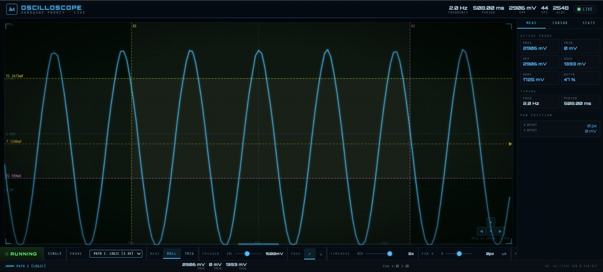
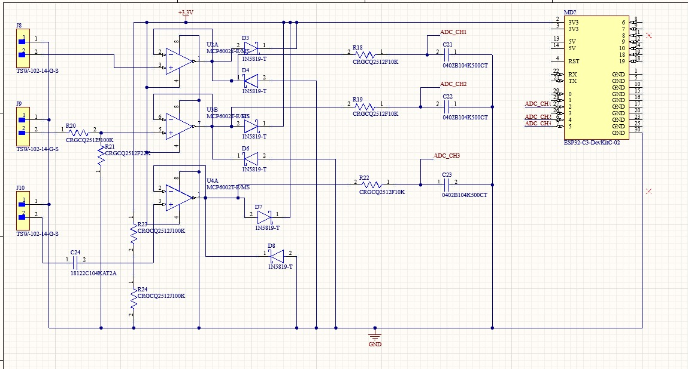
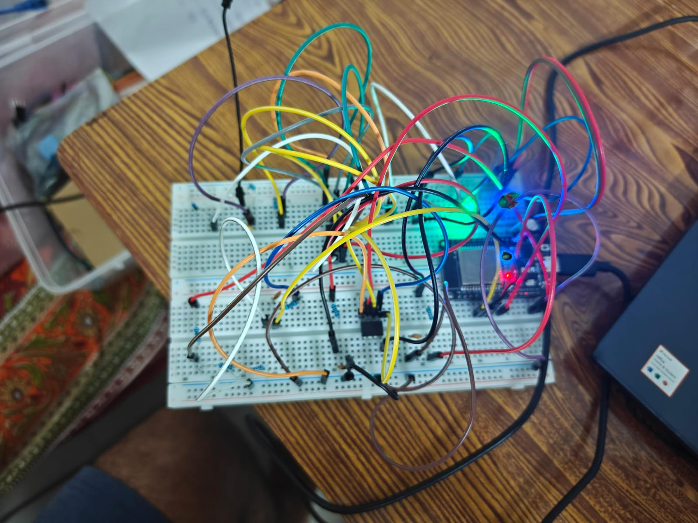

# ESP32 Web Oscilloscope

A 3-channel wireless oscilloscope built around an ESP32. The device samples three analog inputs through a custom op-amp analog front-end, streams live voltage data over WiFi via WebSockets, and renders a full oscilloscope UI (triggering, timebase, cursors, FFT, persistence) directly from a browser — no companion app or desktop software required.



## Overview

- **3 input channels**, each independently conditioned for a different signal class:
  - **CH1 — Logic (0–3.3V)**: direct-coupled, for digital logic / PWM / square waves.
  - **CH2 — High Voltage (0–15V)**: scaled into the ADC's 0–3.3V range via a resistor-divider network.
  - **CH3 — AC / Audio (±1.65V)**: AC-coupled through a series capacitor and biased to the ADC's mid-rail so negative-swinging signals can be sampled safely.
- Each channel is buffered through an **MCP6002 op-amp** (rail-to-rail voltage follower) for high input impedance, and clamped with **1N5819 Schottky diodes** to protect the ESP32's ADC pins from overvoltage.
- Firmware samples all 3 channels, generates a reference sine wave on the onboard DAC, and broadcasts readings over a WebSocket server at ~50 updates/sec.
- The browser UI (served directly from the ESP32's flash) renders the live waveform on an HTML5 canvas, with edge-triggering, adjustable timebase/gain, pan, dual cursors with delta measurements, waveform persistence, an FFT view, and live VMAX/VMIN/VPP/VAVG/VRMS/frequency/duty-cycle computation.

## Hardware

| | |
|---|---|
| Circuit diagram |  |
| Schematic | [docs/schematic.pdf](docs/schematic.pdf) |
| Breadboard build |  |

**Pin mapping (ESP32):**

| Signal | Pin |
|---|---|
| DAC reference output | GPIO 25 |
| ADC CH1 (Logic) | GPIO 34 |
| ADC CH2 (High Voltage) | GPIO 35 |
| ADC CH3 (AC/Audio) | GPIO 32 |
| TX activity LED | GPIO 2 |

## Firmware

- `ESP32_Oscilloscope.ino` — connects to WiFi, serves the UI over HTTP, samples the 3 ADC channels every 20ms, generates a 2Hz DAC sine wave, and broadcasts `"CH1,CH2,CH3"` voltage readings (in mV) over WebSocket on port 81.
- `index.h` — the full browser-based oscilloscope UI (HTML/CSS/JS), stored in flash (`PROGMEM`) and served directly by the ESP32.

## Getting started

1. Open `ESP32_Oscilloscope.ino` in the Arduino IDE (ESP32 board support required).
2. Set your WiFi credentials:
   ```cpp
   const char* ssid = "YOUR_WIFI_SSID";
   const char* password = "YOUR_WIFI_PASSWORD";
   ```


   https://claude.ai/artifact/425A3eNca11TZitofCpdmX
  
4. Flash to an ESP32 dev board, wire up the front-end per the schematic, and open the Serial Monitor to read the assigned IP address.
5. Visit `http://<esp32-ip>/` in a browser to view the live scope.

## Tech

ESP32 · Embedded C++ (Arduino framework) · Analog front-end design (op-amps, resistor dividers, AC coupling) · WebSockets · HTML5 Canvas · EasyEDA
